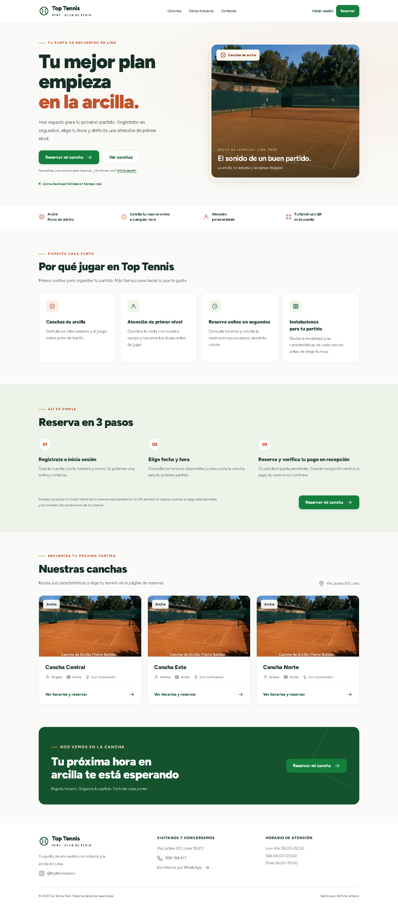
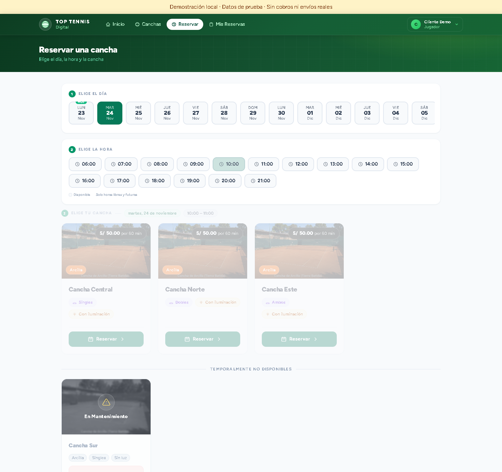
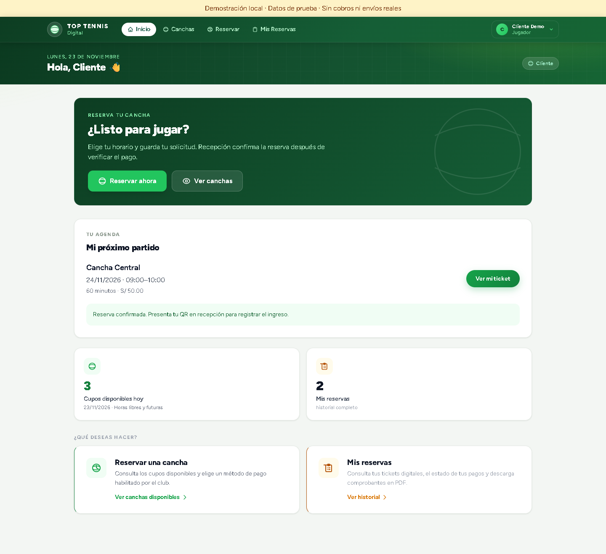
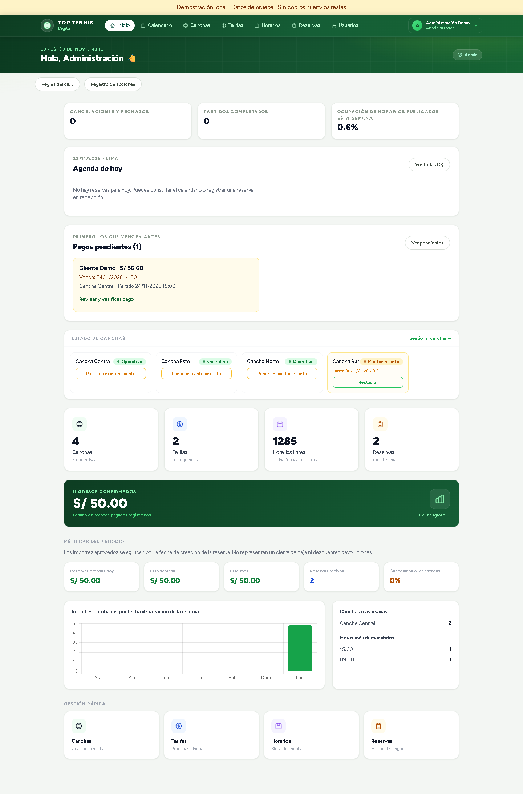
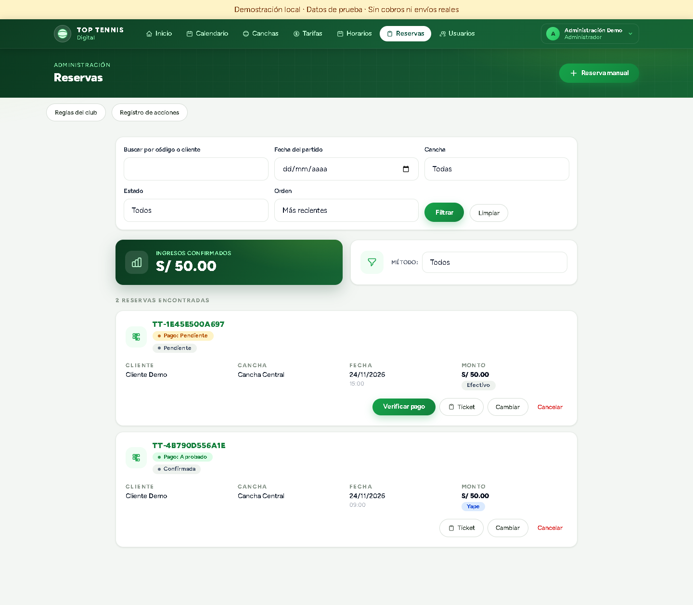
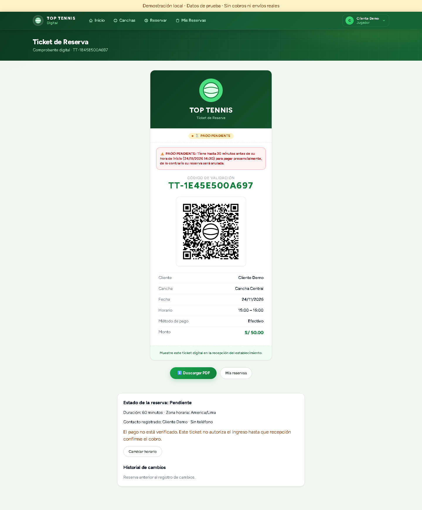

# Top Tennis

Aplicación web para consultar disponibilidad y gestionar reservas de canchas de tenis, desde la solicitud del cliente hasta la revisión del personal del club.

**Proyecto de portafolio de Diego Magallanes Linares.** PHP · Laravel · Blade · Tailwind CSS · Alpine.js · SQL.

## El problema

Los clientes pueden llegar al club sin conocer la disponibilidad y encontrar las canchas ocupadas. La propuesta reúne horarios, reservas y seguimiento en una web. También facilita consultar franjas de baja demanda; todavía no se han medido aumentos de reservas ni resultados comerciales.

## Resultado en imágenes

Capturas tomadas el **23 de noviembre de 2026** sobre una instalación local aislada, con cuentas y reservas ficticias. Los pagos mostrados son demostraciones: no se realizan cobros ni envíos reales.

### Inicio

Presentación del club y acceso a las canchas y reservas.



### Disponibilidad y reservas

El cliente consulta fechas y horarios disponibles antes de elegir una cancha.



### Panel del cliente

Próximo partido, estado de su reserva e información del ticket.



<details>
<summary><strong>Ver administración, gestión de reservas y ticket digital</strong></summary>

### Administración

Agenda, pagos pendientes, estado de canchas e indicadores de la demostración.



### Gestión de reservas

Filtros, estados, verificación de pagos y seguimiento por cliente.



### Ticket digital

Código y QR para consultar el estado de una reserva ficticia.



</details>

## Funcionalidades

- Consulta de canchas y disponibilidad por fecha.
- Reservas, cambios, cancelaciones y vencimiento de solicitudes según reglas del club.
- Perfiles de cliente, recepción y administración, con permisos separados.
- Gestión de canchas, tarifas y horarios; generación de cupos futuros.
- Ticket con QR y descarga en PDF.
- Registro de acciones y paneles de operación.
- Simulación local de pagos con Yape y tarjetas. El efectivo se gestiona presencialmente.

## Aporte de Diego

Identificación de necesidades del negocio, definición de requerimientos, perfiles y reglas; pruebas funcionales, identificación de incidencias y revisión de correcciones. La implementación y evolución del proyecto han contado con **apoyo importante de herramientas de IA**. La publicación no atribuye todo el código a una sola persona.

Consulta la [procedencia y los créditos](UPSTREAM.md). La copia original conserva su propio historial; esta publicación no incluye bases de datos, credenciales ni respaldos privados.

## Tecnologías

| Parte | Tecnología |
|---|---|
| Servidor | PHP 8.3 o superior, sujeto a `composer.lock`; Laravel 13 |
| Interfaz | Blade, Tailwind CSS 3, Alpine.js, Vite |
| Datos | MySQL o SQLite para una demostración local |
| Autenticación | Laravel Breeze y permisos por rol |
| PDF y QR | Dompdf y BaconQrCode |
| Pruebas | PHPUnit y pruebas funcionales de Laravel |

La comprobación de esta entrega utilizó **PHP 8.5.7** y SQLite. Composer comprueba los requisitos exactos del archivo de bloqueo.

## Ejecutar localmente

Requisitos: Git, Composer 2, PHP con las extensiones requeridas por Composer (incluidas `mbstring`, `pdo_sqlite` y `sqlite3` para SQLite), y Node.js 22.12 o superior para compilar la interfaz.

```bash
git clone https://github.com/DiegoMagallanes11/top-tennis.git
cd top-tennis
composer install
php -r "copy('.env.example', '.env');"
php artisan key:generate
php -r "file_exists('database/database.sqlite') || touch('database/database.sqlite');"
php artisan migrate
npm ci
npm run build
php artisan serve
```

Abrir `http://127.0.0.1:8000`. `.env.example` está preparado para SQLite y pagos de demostración; nunca sirve como configuración de producción.

### Cargar datos ficticios

**Solo en una base separada y vacía:**

```bash
php artisan db:seed --class=DemoSeeder
php artisan club:crear-admin administrador@example.com
```

El segundo comando solicita la contraseña en privado. No se publican contraseñas ni cuentas con acceso real. El cliente puede registrarse desde la web; el administrador puede crear al personal de recepción.

El seeder genera datos de demostración, pero no configura una cuenta comercial de Yape ni una pasarela de tarjetas. Si se habilita Yape real, el responsable debe proporcionar su propia configuración y QR; esta publicación no incluye un QR de cobro personal.

## Pruebas y estado

```bash
php artisan test
```

Verificación de esta entrega: **87 pruebas aprobadas y 446 comprobaciones**, en SQLite temporal. Se revisaron seis pantallas en navegador y no se detectaron errores de JavaScript durante ese recorrido. Ver [detalle de validación](docs/validacion-portafolio.md).

Se corrigió la comprobación de propietario de una reserva para aceptar tanto el identificador como el modelo ya resuelto por Laravel. La suite existente cubre las rutas afectadas.

### Límites conocidos

- No hay pasarela bancaria real integrada; los pagos de demostración no mueven dinero.
- El envío real de correos requiere configuración y validación del proveedor.
- La prueba concurrente incluida usa SQLite; no demuestra por sí sola el comportamiento de producción en MySQL.
- El despliegue, las copias de seguridad y su restauración requieren validación en el entorno final.
- No se afirma que el producto esté vendido o en operación comercial.

## Documentación del proyecto

- [Arquitectura](docs/arquitectura.md)
- [Modelo de datos](docs/modelo-de-datos.md)
- [Reglas de negocio](docs/reglas-de-negocio.md)
- [Casos de uso](docs/casos-de-uso.md)
- [Casos de prueba](docs/casos-de-prueba.md)
- [Pagos de demostración](docs/pagos-demostracion.md)
- [Historial de esta publicación](CHANGELOG.md)

## Contacto

[LinkedIn de Diego Magallanes](https://www.linkedin.com/in/diego-magallanes-linares/) · [Perfil de GitHub](https://github.com/DiegoMagallanes11)
